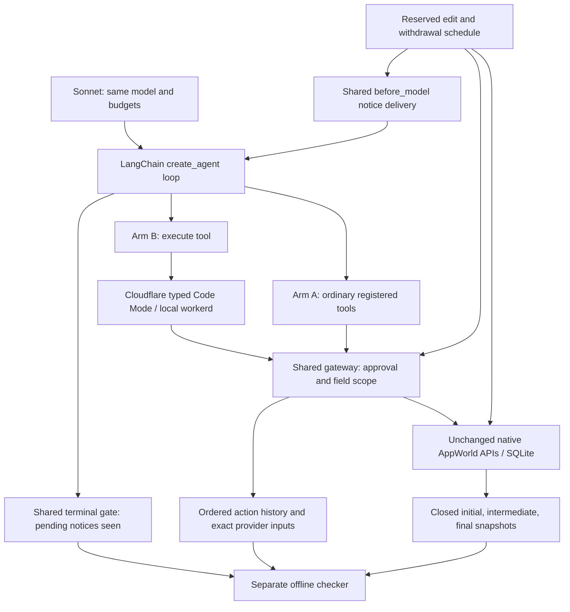

# What was compared

The model chooses observations, actions, and the final report. Ordinary tools send structured arguments through LangChain. Code Mode generates JavaScript against Cloudflare's native typed interface; the local sandbox invokes the same gateway. Both can ask for clarification through the same terminal protocol.

The gateway rejects writes outside a narrow field capability or after approval withdrawal at dispatch admission. It never silently strips arguments. A request admitted before withdrawal may finish afterward. The terminal gate requires pending notices to have appeared in an actual model request before it accepts a final report. Shared safeguards are application engineering; zero observed forbidden effects cannot be credited solely to model reasoning.

A supervisor injects authored interventions into reserved causal windows. It exports closed native state and a journal. The checker imports neither simulator nor agent code and checks intermediate effects as well as final state. It is separate code written in the same project, **not independently authored/reviewed**.

Neither arm has Temporal, a durable checkpoint, deduplication, CAS, automatic rollback, compensation, a new replanner, or a new semantic recovery policy. The runtime cannot cancel an already dispatched native request. Serialization of the local gateway is not atomic authorization across independent production services.

Earlier Cloudflare + Temporal code is preserved in the historical source. Temporal provided execution history/retry/resume infrastructure there; it did not itself define correct business effects or revise code. Earlier results cannot isolate its value from differing agent loops and reporting paths. See the experiment history.
